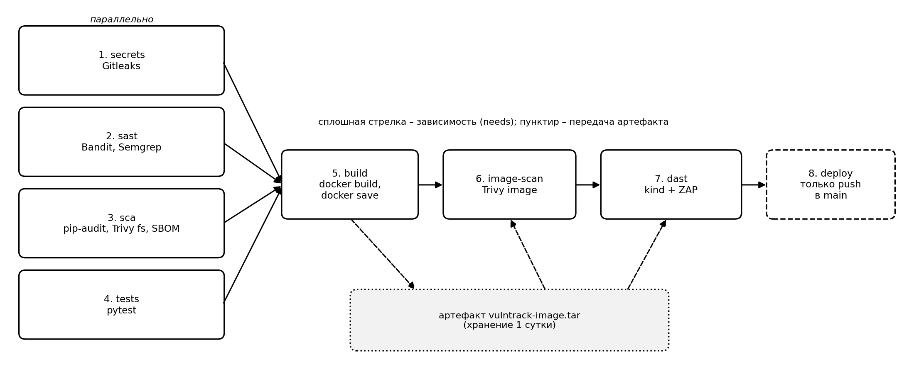
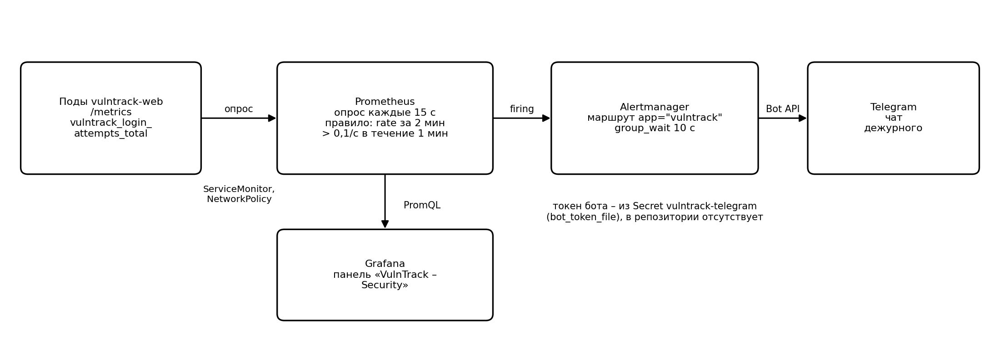

# Secure Delivery Pipeline


Защищённый конвейер непрерывной поставки веб-приложения: от коммита до работы в Kubernetes, с семью воротами безопасности и обнаружением атак в эксплуатации.

Приложение - **VulnTrack**, трекер уязвимостей на FastAPI + PostgreSQL: аналитик импортирует отчёты сканеров и работает со списком уязвимостей своей команды.

**Стек:** Python 3.11 · FastAPI · SQLAlchemy · PostgreSQL 16 · Docker · Kubernetes (minikube, kind) · GitHub Actions · Gitleaks · Bandit · Semgrep · pip-audit · Trivy · OWASP ZAP · Prometheus · Grafana · Alertmanager

## Конвейер



Первые четыре проверки идут параллельно. Сборка начинается, только если все они прошли. Образ собирается **один раз**, и скан образа, DAST и деплой работают с одним и тем же артефактом.

| № | Этап | Инструменты | Что блокирует поставку |
|---|---|---|---|
| 1 | Поиск секретов | Gitleaks + собственное правило | Секрет в коммитах PR / push |
| 2 | SAST | Bandit, Semgrep (+ своё правило) | Находка Bandit ≥ MEDIUM, любое срабатывание Semgrep |
| 3 | SCA | pip-audit, Trivy fs, SBOM (CycloneDX) | Известная уязвимость в зависимостях (HIGH/CRITICAL с исправлением) |
| 4 | Тесты | pytest | Падение теста, в том числе регрессионные тесты мер защиты |
| 5 | Сборка | Docker (`docker save` → артефакт) | Ошибка сборки |
| 6 | Скан образа | Trivy image | HIGH/CRITICAL в итоговом образе |
| 7 | DAST | kind + OWASP ZAP (аутентифицированный full scan) | Правило FAIL, недоступность стенда после скана, cookie без HttpOnly |
| 8 | Деплой | - | Выполняется только для `push` в `main` после всех ворот |

Детали, которые стоит посмотреть в [`security.yml`](.github/workflows/security.yml):
- `permissions: contents: read` на весь workflow, расширение прав только точечно;
- `trivy-action` закреплён по SHA: в марте 2026 его теги были перезаписаны вредоносным кодом (CVE-2026-33634);
- DAST разворачивает те же манифесты, что и прод, в одноразовом кластере kind с одноразовыми секретами;
- ZAP сканирует под залогиненным пользователем, а решения по правилам задокументированы в [`.zap/rules.tsv`](.zap/rules.tsv);
- **закрытые ворота:** если после сканирования стенд не отвечает, задание красное, потому что «уязвимостей не найдено» без доказанного скана не засчитывается.

Рядом лежит [`baseline.yml`](.github/workflows/baseline.yml): тот же проект без проверок безопасности (тесты → сборка → деплой). Он нужен для сравнения времени и результатов.

## Среда выполнения

**Образ** ([`Dockerfile`](Dockerfile)):
- многоэтапная сборка на `python:3.11-slim`;
- пользователь с UID 10001;
- из итогового образа удалены `pip`, `setuptools` и `wheel`;
- gunicorn + uvicorn workers, HEALTHCHECK.

Размер образа: **1,81 ГБ → 264 МБ** по сравнению с наивным `FROM python:3.11` + `COPY . .`.

**Kubernetes** ([`k8s/`](k8s/)):
- securityContext приложения уровня `restricted`: `runAsNonRoot`, `readOnlyRootFilesystem`, `drop: [ALL]`, seccomp `RuntimeDefault`, без токена сервисной учётки;
- Pod Security Admission: `enforce: baseline`, `warn/audit: restricted`;
- NetworkPolicy: всё входящее запрещено по умолчанию, к БД ходит только приложение, к метрикам — только из пространства имён monitoring;
- RBAC: учётка только на чтение;
- явно настроенные liveness/readiness-пробы и лимиты ресурсов;
- секреты в манифестах отсутствуют и создаются в кластере.

## Мониторинг атак



Приложение экспортирует счётчик попыток входа. Правило Prometheus срабатывает, когда скорость неудачных входов превышает 0,1/с в течение минуты, и Alertmanager шлёт оповещение в Telegram. На тестовом стенде подбор пароля обнаруживался за **2 мин 21 с**. Неудачные входы дополнительно пишутся в журнал приложения (пользователь, IP).

## Что нашлось на практике

- **Ложный PASS в DAST.** `kubectl port-forward` рвался под нагрузкой активного скана, атакующие запросы не доходили, и XSS «не находилась». Решение: NodePort плюс проверка, что стенд жив после скана.
- **Уязвимости, которых нет в `requirements.txt`.** Скан образа нашёл CVE-2026-23949 и CVE-2026-24049 во встроенных зависимостях `setuptools` базового образа. Анализ зависимостей их не видел, а конвейер без проверок спокойно пропустил бы такой образ.
- **Подбор пароля как DoS.** bcrypt на каждую попытку, низкий лимит CPU и пробы по умолчанию (1 с) давали каскад перезапусков подов. Ни одни ворота конвейера этого не ловят, поймал только мониторинг.

## Быстрый старт

Локально через Docker Compose:

```bash
cp .env.example .env        # заполнить POSTGRES_PASSWORD и VULNTRACK_SECRET_KEY
docker compose up --build   # http://127.0.0.1:8000
```

В minikube (сетевые политики требуют CNI с их поддержкой):

```bash
minikube start --cni=calico
docker build -t vulntrack:local .
minikube image load vulntrack:local
kubectl apply -f k8s/00-namespace.yaml
# создать секреты — команды в комментарии k8s/01-config.yaml
kubectl apply -f k8s/01-config.yaml -f k8s/02-postgres.yaml -f k8s/03-web.yaml -f k8s/04-networkpolicy.yaml -f k8s/06-rbac.yaml
```

Тесты:

```bash
pip install -r requirements.txt -r requirements-dev.txt
VULNTRACK_SECRET_KEY=$(openssl rand -hex 32) pytest -q
```

Для CI в настройках репозитория нужен секрет `VULNTRACK_SECRET_KEY`.

## Известные ограничения

- Нет CSRF-токенов в формах. Частично смягчает `SameSite=Lax`, правило ZAP 10202 стоит как WARN.
- Нет ограничения частоты попыток входа (rate limiting), поэтому атака на `/login` грузит CPU.
- Команда пользователя задаётся при регистрации; в реальной системе её назначал бы администратор.
- Исходящий трафик подов не ограничен.
- Секреты хранятся в объектах Secret; для прода — Vault или Sealed Secrets.
- `pip-audit` и `semgrep` в `requirements-dev.txt` не закреплены по версиям.
- Остальные GitHub Actions подключены по тегам, по SHA закреплён только Trivy.
- Деплой -  заглушка: реестр и рабочий кластер не подключены.
