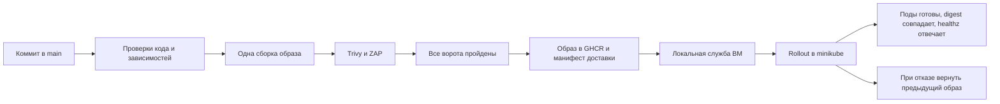

# Доставка проверенного образа на minikube

GitHub Actions проверяет и публикует контейнер, а локальная служба Linux забирает разрешённую сборку и обновляет Kubernetes. Публичный репозиторий не имеет runner на ВМ, доступа по SSH и kubeconfig. Код PR на ВМ не выполняется. Саму службу оператор устанавливает из просмотренной версии; автоматического обновления её кода нет.



## Тот же образ

Сборка сохраняется один раз в `vulntrack-image.tar`. `image-build.json` содержит SHA-256 архива, идентификатор конфигурации контейнера, репозиторий, коммит и номер запуска. Trivy и kind/ZAP используют этот архив. После всех ворот публикация повторно проверяет архив и идентификатор, загружает его в Docker и отправляет в GHCR **без пересборки**.

Имя образа имеет вид `ghcr.io/sk8le/secure-delivery-pipeline:verified-<запуск>-<попытка>`. В Kubernetes используется неизменяемая ссылка `ghcr.io/sk8le/secure-delivery-pipeline@sha256:...`. Успешный запуск создаёт prerelease `delivery-<запуск>-<попытка>` с `deployment.json`; это запись доставки, а не ручная версия приложения.

Задание публикации работает только на push в main, после итоговых ворот. Временный GITHUB_TOKEN имеет права публикации пакета и release только в этом задании. ВМ не требует GitHub-токенов: публичные сведения о запуске, release и публичный образ читаются анонимно.

## Первый запуск: публичность пакета

GitHub может создать новый пакет GHCR приватным, даже для публичного репозитория. После первого push оператор должен открыть настройки пакета `secure-delivery-pipeline` в Packages и сделать его публичным. Ключи или пароли для этого в репозиторий не добавляются.

Публикация проверяет скачивание через отдельную пустую конфигурацию Docker, без сохранённого входа. Пока пакет недоступен анонимно, задание завершается ошибкой и разрешение на доставку не публикуется. После изменения видимости можно повторить неуспешное задание. Исходный проверенный архив сохраняется; новая попытка публикации указывается отдельно от попытки сборки.

## Подготовка ВМ

Требуются запущенный minikube, приложение `vulntrack-web` в namespace `vulntrack`, контейнер `web`, Python 3 и kubectl. ВМ должна иметь исходящий HTTPS-доступ к GitHub/GHCR. Контекст kubectl должен называться `minikube`.

Настройку cookie выбирает оператор: для текущего стенда по HTTP — `VULNTRACK_COOKIE_SECURE=false`, для HTTPS — `true`. Секреты приложения и БД сохраняются в существующем Deployment; служба их не создаёт и не меняет.

Установить из просмотренной копии репозитория:

```bash
bash deploy/install-user-service.sh
/usr/bin/python3 ~/.local/lib/vulntrack-delivery/deploy_verified.py --check-only
```

Первый вывод может быть `no_new_verified_delivery`: для текущей main ещё нет разрешённой доставки, либо она уже установлена. Флаг `--check-only` не меняет Kubernetes.

Включить автоматическую проверку каждые пять минут:

```bash
systemctl --user enable --now vulntrack-delivery.timer
systemctl --user list-timers vulntrack-delivery.timer --no-pager
```

Если служба должна работать после выхода пользователя и запускаться при загрузке ВМ:

```bash
sudo loginctl enable-linger "$USER"
```

minikube должен быть запущен отдельно; служба доставки сама не поднимает кластер.

## Условия допуска на ВМ

Служба сверяет репозиторий, workflow, событие push/main, успешное завершение запуска и совпадение с текущим коммитом main. Проверяются автор release `github-actions[bot]`, целевой коммит тега, адрес и SHA-256 манифеста, фиксированный репозиторий GHCR и digest образа. Неуспешный запуск, PR/fork, устаревшая версия main, отсутствующий release или подменённый манифест не допускаются.

Перед обновлением main проверяется повторно. Kubernetes обновляется с проверкой resourceVersion, чтобы не затереть параллельное изменение. После rollout проверяются готовность всех реплик, ссылки на образ и фактические imageID; containerd может возвращать digest манифеста или конфигурации образа. Дополнительно проверяется `/healthz`.

При отказе возвращается предыдущий образ, если Deployment всё ещё относится к этой попытке. Если оператор уже изменил его, автоматический откат не выполняется. Запись об успехе создаётся только после всех проверок.

## Подтверждение результата

```bash
systemctl --user start vulntrack-delivery.service
journalctl --user -u vulntrack-delivery.service -n 50 --no-pager
cat ~/.local/state/vulntrack-delivery/last-success.json
kubectl -n vulntrack get pods -l app=vulntrack-web -o wide
```

`last-success.json` связывает коммит, запуск CI, точный образ, время выкладки, предыдущий образ и фактические imageID подов. До появления этой записи публикация образа не считается подтверждённой выкладкой на ВМ. Этот файл и вывод Kubernetes сохраняются для экспериментов.

Отключение: `systemctl --user disable --now vulntrack-delivery.timer`. Оно прекращает новые проверки и не останавливает приложение.

Ограничения: публикация и применение происходят в разных процессах; GitHub подтверждает публикацию, а готовность ВМ подтверждается локальным отчётом. Интервал таймера входит в задержку доставки. Доверенными остаются владелец репозитория, GitHub Actions и локальная учётная запись оператора; компрометацию этих сторон данный механизм не устраняет.
